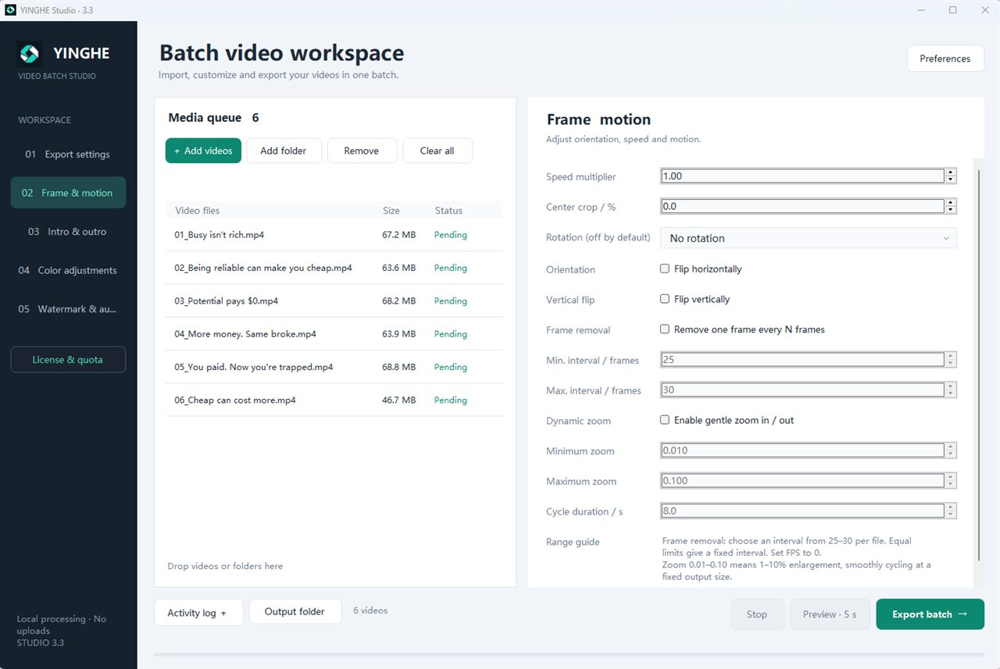

# YINGHE Studio

English · [简体中文](README.zh-CN.md)

**A local batch video workspace for Windows and Mac.** Bring your videos together, combine processing settings and export the queue on your own computer. Spend less time repeating the same edits.

*Actual Windows workspace. Mac has its own native interface; available controls and hardware encoders vary by platform.*

**[Download on GitHub](https://github.com/jo3sheng/yinghe-studio/releases)** · **[Baidu shared folder](https://pan.baidu.com/s/1pQZ48qI7X-fQc2ppgx84rg?pwd=dp5p)** · Access code: **dp5p**

## One workspace for a whole batch

- **Batch import and export:** add videos or a folder, manage a queue and apply processing settings across the batch.
- **Crop and reframe:** resize, center-crop, rotate and flip your footage horizontally or vertically.
- **Motion variations:** combine speed changes, interval frame removal and dynamic zoom to vary how a clip looks and moves.
- **Color controls:** refine exposure, brightness, contrast, saturation, highlights, shadows, color temperature and other controls available in your version.
- **Your branding:** place watermarks, adjust their position and opacity, and add image or video picture-in-picture.
- **Intros and outros:** give the batch a consistent opening and ending using video segments or still images.
- **Audio and output:** work with original audio and background music; set output resolution, frame rate and bitrate.
- **Preview before committing:** check a five-second preview, then export the full queue.
- **Local processing:** rendering runs on your computer; your footage does not need to be uploaded for processing. FFmpeg and FFprobe are included in the complete software packages.

See the [Windows guide](docs/USER-GUIDE.md) or the [Mac manuals](https://github.com/jo3sheng/yinghe-studio/releases/download/v1.1.6-macos/YINGHE-Studio-1.1.6-Manuals-9-Languages.zip) for controls supported by your platform and version. Motion variations are editing tools, not a guarantee of duplicate-detection avoidance or copyright clearance.

## Free is useful for everyday work

Download and start without registering, verifying an email or collecting a Free code. Free includes the processing tools and **10 successful full exports per local day**. Previews, failures and cancellations do not use that allowance.

| Feature | Free | Pro |
| --- | --- | --- |
| Video processing tools in your version | Included | Included |
| Five-second preview | Included | Included |
| Successful full exports | 10 per day | No daily cap during the license term |
| Preview, failure or cancellation | Does not count | Does not count toward the Free allowance |
| Registration to start Free | Not required | Purchased code required for Pro activation |
| Price | Free | **US$49 / 365 days** |
| Automatic renewal | None | None; renew manually |
| Active Pro computers | — | One per license |

**Upgrade when the daily allowance gets in your way.** Studio Pro provides 365 days of uncapped exports for **US$49**. It is a one-year license with manual renewal, not a lifetime purchase or an automatically renewing subscription.

Activate online, then process videos offline. To move a license, unbind the old computer online before activating the same code on the new one. Expiry or unbinding restores Free while retaining recorded usage for that day.

[Buy Studio Pro](https://buy.stripe.com/fZufZi7Jc4Nv5XBa383AY03) · [Compare plans](https://yinghe.org/pricing.html) · [Recover a code](https://yinghe.org/account.php) · [Buy me a coffee](https://buy.stripe.com/28E9AU6F85Rz0Dh5MS3AY00)

Coffee is optional support. It does not purchase Pro or increase the Free allowance.

## 9 interface languages

English, Simplified Chinese, Traditional Chinese, French, Japanese, Spanish, German, Russian and Korean. Choose the language in preferences. Mac PDF manuals are also available in nine languages.

## Download and install

| Platform | Current package | Requirements | Download |
| --- | --- | --- | --- |
| Windows | 3.3.3 | 64-bit Windows 10/11; .NET Framework 4.8 recommended | [Complete Windows ZIP](https://github.com/jo3sheng/yinghe-studio/releases/download/v3.3.3/YINGHE-Studio-3.3.3-Windows.zip) |
| Mac | 1.1.6 | macOS 13+; Apple Silicon (M-series) | [Complete Mac ZIP](https://github.com/jo3sheng/yinghe-studio/releases/download/v1.1.6-macos/YINGHE-Studio-1.1.6-MAC.zip) |

The Studio Mac package above **does not support Intel Macs**. Both complete packages include FFmpeg and FFprobe; keep their bundled files intact. Fully extract the Windows archive before running `YINGHE-Studio.exe`. Extract the Mac archive and follow the PDF manual supplied with the app.

[Installation guide](docs/INSTALL.md) · [Nine-language Mac manuals](https://github.com/jo3sheng/yinghe-studio/releases/download/v1.1.6-macos/YINGHE-Studio-1.1.6-Manuals-9-Languages.zip) · [All releases](https://github.com/jo3sheng/yinghe-studio/releases)

The shared Baidu folder is used by both Studio and Voice Changer. Select the correct product and platform inside it.

## Checksums and support

[Windows SHA-256](https://github.com/jo3sheng/yinghe-studio/releases/download/v3.3.3/YINGHE-Studio-3.3.3-Windows.zip.sha256) · [Mac and manuals SHA-256](https://github.com/jo3sheng/yinghe-studio/releases/download/v1.1.6-macos/SHA256SUMS-macOS-1.1.6.txt)

Checksums verify download integrity; they are not a code-signing certificate. Apple Developer ID signing and notarization have not been independently verified for this Studio Mac package. See the installation guide for current packaging notes.

[Release history](CHANGELOG.md) · [Report a software problem](https://github.com/jo3sheng/yinghe-studio/issues/new/choose) · [Private support](mailto:licenses@yinghe.org)

## About the “Source code” archives

This is the official product download, documentation and support repository. **YINGHE Studio application source and its licensing backend remain private.** GitHub automatically labels repository snapshots “Source code”; those snapshots contain these product documents and assets, not the application development source. Installers are attached to Releases. [Third-party components retain their own licenses](THIRD-PARTY-NOTICES.md).

[Product website](https://yinghe.org/studio.html) · [Voice Changer](https://github.com/jo3sheng/yinghe-voice-changer)
