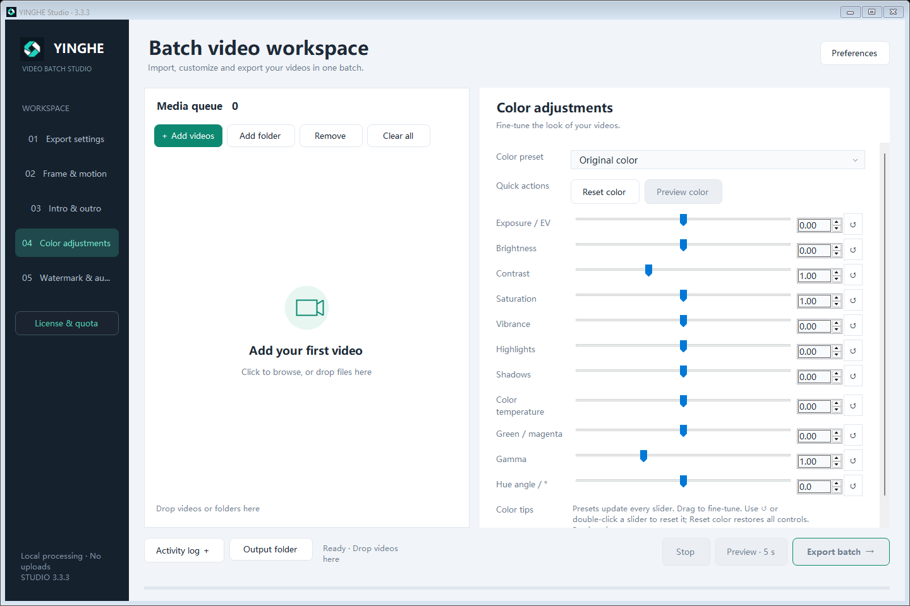

<h1 align="center">YINGHE Studio · 映核</h1>

Local batch video processing for Windows and Mac. 本地批量处理视频，减少重复操作。

<a href="https://yinghe.org"><strong>Official website · 官网：yinghe.org</strong></a> <a href="https://yinghe.org/pricing.html">Free & Pro · 版本与价格</a> · <a href="https://yinghe.org/support.php">Buy a coffee · 请我喝杯咖啡</a> · <a href="https://github.com/jo3sheng/yinghe-studio/issues">Feedback · 问题反馈</a>

## Download / 下载

| Platform / 平台 | Version / 版本 | Direct download / 直接下载 |
| --- | --- | --- |
| **Windows** | **3.3.3** | **[Download Windows ZIP · 下载完整包](https://github.com/jo3sheng/yinghe-studio/releases/download/v3.3.3/YINGHE-Studio-3.3.3-Windows.zip)** |
| **Mac · Apple Silicon** | **1.1.6** | **[Download Mac ZIP · 下载完整包](https://github.com/jo3sheng/yinghe-studio/releases/download/v1.1.6-macos/YINGHE-Studio-1.1.6-MAC.zip)** |
| Mac PDF manuals / 使用手册 | 9 languages / 九种语言 | [Download manuals ZIP · 下载手册](https://github.com/jo3sheng/yinghe-studio/releases/download/v1.1.6-macos/YINGHE-Studio-1.1.6-Manuals-9-Languages.zip) |

**Both software packages include FFmpeg and FFprobe. No separate installation is needed.** 
两个软件包都已内置 FFmpeg、FFprobe，完整解压即可按说明使用。

- **Windows:** 64-bit Windows 10/11; .NET Framework 4.8 recommended. 建议 64 位 Windows 10/11 与 .NET Framework 4.8。
- **Mac:** macOS 13 or later, Apple Silicon (M-series). This download does not support Intel Macs. 需要 macOS 13 及以上、Apple Silicon（M 系列芯片），不适用于 Intel Mac。

[Installation / 安装说明](docs/INSTALL.md) · [Windows release notes](https://github.com/jo3sheng/yinghe-studio/releases/tag/v3.3.3) · [Mac release notes](https://github.com/jo3sheng/yinghe-studio/releases/tag/v1.1.6-macos) · [Checksums / 文件校验](#checksums--文件校验)

> Choose a **software ZIP** above. GitHub's automatic **Source code** downloads contain this repository's documentation, not the application or its development source. 请下载上方的软件 ZIP。GitHub 自动显示的 **Source code** 压缩包只有本仓库文档，不是软件安装包，也不含映核开发源码。

## What it does / 主要功能

- **Batch workflow / 批量处理** — import videos, choose settings, preview a short sample and export one output per input. 导入视频、统一设置、先看短预览，再逐个导出。
- **Frame and appearance / 画面调整** — resize, crop, rotate, flip, adjust playback speed and color. 调整尺寸、裁剪、旋转、翻转、速度和色彩。
- **Branding and audio / 标识与声音** — watermarks, picture in picture, intros/outros and background music. 添加水印、画中画、片头片尾与背景音乐。
- **Local processing / 本地运行** — video processing runs on your computer; footage is not uploaded for rendering. 视频在自己的电脑上处理，渲染无需上传素材。

Controls and hardware encoding options vary by platform. See the [Windows guide](docs/USER-GUIDE.md) or the [Mac PDF manuals](https://github.com/jo3sheng/yinghe-studio/releases/download/v1.1.6-macos/YINGHE-Studio-1.1.6-Manuals-9-Languages.zip) for the version you use.

<strong>View the Windows interface / 查看 Windows 软件界面</strong>

Windows interface examples; these are not Mac screenshots. / 以上为 Windows 界面示例，并非 Mac 截图。

## Free & Pro / 免费版与专业版

| | Free / 免费版 | Pro / 专业版 |
| --- | --- | --- |
| Getting started / 开始使用 | No registration / 无需注册 | Activate a purchased code / 购买注册码后激活 |
| Export allowance / 导出额度 | 10 successful full exports per local day / 每天成功导出 10 个 | No daily cap while licensed / 有效期内不限数量 |
| Preview, failure, cancellation / 预览、失败、取消 | Do not count / 不计数 | Do not count toward the Free allowance / 不扣免费额度 |
| Price / 价格 | Free / 免费 | **US$49 / 365 days** · manual renewal / 手动续期 |
| Pro device limit / 专业版设备数 | — | One active computer / 同时激活一台电脑 |

**[View plans / 查看方案](https://yinghe.org/pricing.html)** · [Purchase Pro / 购买专业版](https://yinghe.org/buy.php) · [Recover a code / 找回注册码](https://yinghe.org/account.php)

Pro requires internet for activation and device unbinding; later video processing supports offline use. To change computers, unbind the old one online, then activate the same code on the new one. Expiry or unbinding restores Free and retains recorded usage for that day. 
专业版激活、解绑时需要联网，之后支持离线处理。换机时先在旧电脑联网解绑，再到新电脑激活；到期或解绑后恢复免费版，当日用量保留。

Coffee support is voluntary and separate from Pro. / 咖啡支持完全自愿，不包含专业版授权。

## Help / 使用帮助

- **[Installation / 安装说明](docs/INSTALL.md)** · [Windows guide / Windows 使用指南](docs/USER-GUIDE.md) · [Mac manuals / Mac 手册](https://github.com/jo3sheng/yinghe-studio/releases/download/v1.1.6-macos/YINGHE-Studio-1.1.6-Manuals-9-Languages.zip)
- **[Release history / 更新记录](CHANGELOG.md)** · [Report a software problem / 反馈软件问题](https://github.com/jo3sheng/yinghe-studio/issues/new/choose)
- **Orders, activation and private support / 订单、激活及私密问题：** [licenses@yinghe.org](mailto:licenses@yinghe.org)

Do not post registration codes, payment details, private videos or unredacted logs in public issues. 
请勿在公开反馈中上传注册码、付款资料、私人视频或未清理个人信息的日志。

## Checksums / 文件校验

[Windows SHA-256](https://github.com/jo3sheng/yinghe-studio/releases/download/v3.3.3/YINGHE-Studio-3.3.3-Windows.zip.sha256) · [Mac and manuals SHA-256](https://github.com/jo3sheng/yinghe-studio/releases/download/v1.1.6-macos/SHA256SUMS-macOS-1.1.6.txt)

Checksums verify download integrity. They are not a code-signing certificate. / 校验值用于检查文件完整性，不等同于代码签名证书。

## About this repository / 关于本仓库

This is the official product download and support repository. YINGHE Studio is proprietary software; its application source and licensing backend are private. Public files here are documentation, screenshots and release downloads. [Third-party software retains its own licenses](THIRD-PARTY-NOTICES.md).

本仓库用于官方软件下载、说明和问题反馈。映核应用源码与授权后台保持私有；第三方组件遵循各自许可证。

**[yinghe.org](https://yinghe.org)**
