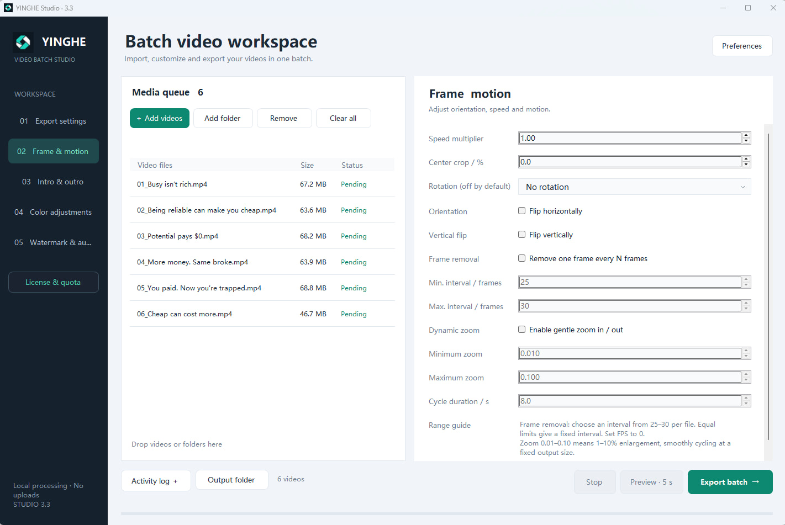

# YINGHE Studio · 映核

**Local batch video processing for Windows.**

[Website](https://yinghe.org) · [Downloads](https://github.com/jo3sheng/yinghe-studio/releases) · [Free & Pro](https://yinghe.org/pricing.html) · [中文说明](#中文说明)

Import videos, configure adjustments, preview five seconds, then export the queue. Each input produces its own output. Video processing runs locally.

## Download

| Platform | Availability |
| --- | --- |
| Windows 10/11, 64-bit | [3.3.3 portable app package](https://github.com/jo3sheng/yinghe-studio/releases/tag/v3.3.3). Requires .NET Framework 4.8 and a separate FFmpeg/FFprobe installation. |
| macOS | Native edition in preparation. An installable, verified Mac release is not published here yet. |

Download the explicitly named **Windows-App.zip** asset. GitHub's automatic **Source code** archives contain these product documents, not the desktop app or its source.

The lightweight Windows package does **not** bundle FFmpeg. Follow the [installation guide](docs/INSTALL.md). The current executable is not Authenticode signed; Windows may show a publisher or reputation warning. Compare the download with the release's SHA-256 checksum. A matching checksum confirms integrity, not publisher trust.

## Features

- Sequential batch processing, folder import and unfinished queue recovery.
- Portrait, landscape, square and custom dimensions; fit, fill, crop, rotation and flips.
- Trim, playback speed, frame removal, animated zoom and image/video intros and outros.
- Color sliders and numeric inputs, presets, exposure, highlights, shadows, vibrance and tint.
- Image watermarks, picture in picture, source audio and looping background music.
- H.264/AAC MP4 export; CPU and compatible NVIDIA/Intel encoding options.
- English, 简体中文, 繁體中文, Français, 日本語, Español, Deutsch, Русский and 한국어.

Hardware encoding depends on your FFmpeg build, GPU and drivers. The app does not provide a general multitrack timeline, subtitle editor or LUT manager.

## Free and Pro

| | Free | Pro |
| --- | --- | --- |
| Registration | No registration or free activation code required | Purchased registration code |
| Exports | 10 successful full exports per local day | No daily export cap while the license is valid |
| Preview, failed or cancelled tasks | Do not consume the allowance | Do not consume the Free allowance |
| Price | Free | US$49 for 365 days; manual renewal |
| Devices | Local use | One active computer per license |
| Connection | No initial online activation | Online activation, then offline use supported |

[Purchase Pro](https://yinghe.org/buy.php) · [Recover a code](https://yinghe.org/account.php) · [Optional coffee support](https://yinghe.org/support.php)

Purchases are handled on the official website. Available payment methods are shown at checkout. Coffee support does not buy or renew Pro. Expiry or online unbinding returns the app to Free without resetting recorded daily usage. To change computers, unbind the old computer online, then activate the original code on the new one. Contact support if the old computer is unavailable.

## Help and feedback

- [Installation](docs/INSTALL.md) · [User guide](docs/USER-GUIDE.md) · [Release notes](CHANGELOG.md)
- [Report a bug](https://github.com/jo3sheng/yinghe-studio/issues/new/choose) for reproducible software problems.
- Email **licenses@yinghe.org** for orders, activation, refunds and sensitive reports.
- Please do not post registration codes, payment details, private videos or unredacted logs in public issues.

## Repository scope

This is the official **product distribution and support repository**. It contains documentation, screenshots and release downloads. YINGHE Studio is proprietary software; desktop source, licensing services, credentials and internal test/deployment files are kept private. Third-party software retains its own licenses; see [third-party notices](THIRD-PARTY-NOTICES.md).

## 中文说明

**映核是本地批量视频处理软件。** 导入素材、设置参数、先看五秒预览，再顺序导出；每个输入独立生成一个输出，素材无需上传。

- **免费版**：下载即用，无需注册或领取注册码，每个本地自然日成功导出 10 个视频；预览、失败和取消不计数。
- **专业版**：49 美元 / 365 天，不自动续费，有效期内不限每日导出数量，同时激活一台电脑。首次联网激活，之后支持离线使用。
- **换机**：旧电脑联网解绑后恢复免费版，新电脑使用原注册码激活；到期或解绑不清零当日用量。
- **咖啡支持**：完全自愿，与专业版购买分开，不增加额度或升级授权。
- **Windows 下载**：前往 [Releases](https://github.com/jo3sheng/yinghe-studio/releases/tag/v3.3.3)，下载名称含 Windows-App.zip 的软件本体包。需另行准备 FFmpeg 和 FFprobe，详见[安装说明](docs/INSTALL.md)。
- **Mac**：原生版本正在准备，当前未在这里发布已验证的可安装成品；不会把源码 ZIP 冒充安装包。

本仓库公开产品说明、截图、安装包及问题反馈，软件源码与授权后台保持私有。GitHub 自动生成的 Source code ZIP 仅为本仓库文档，不是软件安装包。

[官网](https://yinghe.org) · [购买专业版](https://yinghe.org/buy.php) · [请作者喝杯咖啡](https://yinghe.org/support.php) · 支持邮箱：licenses@yinghe.org
