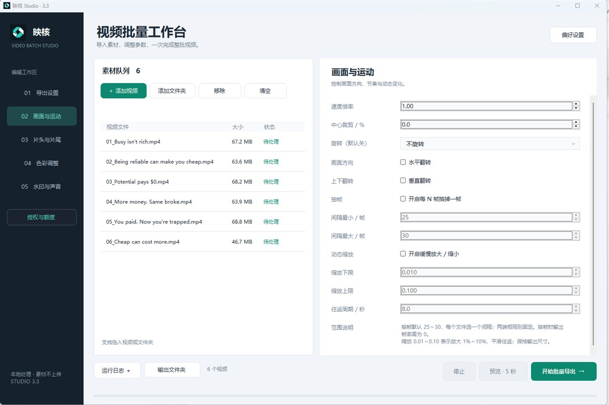

# 映核工作室

[English](README.md) · 简体中文

**面向 Windows 与 Mac 的本地批量视频工作台。** 导入整批素材、组合处理参数，再交给自己的电脑导出，减少一遍遍重复设置。

*以上为真实 Windows 界面；Mac 使用独立的原生界面。不同系统与版本的功能控件、硬件编码选项有所差异。*

**[前往 GitHub 下载](https://github.com/jo3sheng/yinghe-studio/releases)** · **[打开百度共享网盘](https://pan.baidu.com/s/1pQZ48qI7X-fQc2ppgx84rg?pwd=dp5p)** · 提取码：**dp5p**

## 把反复操作，收进同一工作台

- **批量导入与导出：**添加视频或文件夹，统一管理素材队列，将处理参数应用到整批视频。
- **裁切与构图：**调整尺寸、中心裁切、旋转、水平或垂直翻转，为不同画幅重新组织画面。
- **画面差异化处理：**组合变速、间隔抽帧与动态缩放，让素材的节奏和运动产生变化。
- **色彩打磨：**按当前版本调节曝光、亮度、对比度、饱和度、高光、阴影、色温等参数。
- **品牌标识：**添加水印、调整位置和透明度，也可叠加图片或视频画中画。
- **片头与片尾：**使用视频片段或定时长图片，统一整批作品的开场与收尾。
- **声音与输出参数：**搭配原声、背景音乐，设置输出分辨率、帧率与码率。
- **先预览，再处理整批：**正式导出前查看五秒预览，确认效果后再执行完整队列。
- **本地处理：**视频在自己的电脑上渲染，无需上传素材；完整软件包内置 FFmpeg 与 FFprobe。

各平台的具体能力以 [Windows 使用指南](docs/USER-GUIDE.md) 和 [Mac 使用手册](https://github.com/jo3sheng/yinghe-studio/releases/download/v1.1.6-macos/YINGHE-Studio-1.1.6-Manuals-9-Languages.zip) 为准。画面差异化功能属于编辑工具，不保证规避平台重复检测，也不改变素材的版权归属。

## 免费版就能完成日常批量处理

下载即可开始，无需注册、验证邮箱或领取免费注册码。免费版包含当前版本的视频处理工具，**每天可成功正式导出 10 个视频**。预览、失败与取消不消耗额度。

| 功能 | 免费版 | 专业版 |
| --- | --- | --- |
| 当前版本的视频处理工具 | 包含 | 包含 |
| 五秒预览 | 包含 | 包含 |
| 成功正式导出 | 每天 10 个 | 授权有效期内不限数量 |
| 预览、失败与取消 | 不计数 | 不扣免费额度 |
| 开始使用 | 无需注册 | 购买注册码后激活专业版 |
| 价格 | 免费 | **US$49／365 天** |
| 自动续费 | 无 | 无，手动续期 |
| 专业版活跃设备数 | — | 每个授权同时激活一台电脑 |

**需要更大处理量时，再升级专业版。** US$49 购买 365 天不限量导出授权；这是手动续期的一年授权，不是终身买断，也不会自动扣费。

首次联网激活后可离线处理。更换电脑时，先在旧电脑联网解绑，再用同一个注册码在新电脑激活；到期或解绑后恢复免费版，当日已记录的用量保留。

[购买工作室专业版](https://buy.stripe.com/fZufZi7Jc4Nv5XBa383AY03) · [详细对比方案](https://yinghe.org/pricing.html) · [找回注册码](https://yinghe.org/account.php) · [请我喝杯咖啡](https://buy.stripe.com/28E9AU6F85Rz0Dh5MS3AY00)

咖啡为自愿支持，不购买专业版，也不增加免费导出额度。

## 9 种界面语言

支持英语、简体中文、繁体中文、法语、日语、西班牙语、德语、俄语和韩语，在偏好设置中选择。Mac PDF 手册也提供九种语言。

## 下载与安装

| 平台 | 当前安装包 | 系统要求 | 下载 |
| --- | --- | --- | --- |
| Windows | 3.3.3 | 建议 64 位 Windows 10／11 与 .NET Framework 4.8 | [Windows 完整压缩包](https://github.com/jo3sheng/yinghe-studio/releases/download/v3.3.3/YINGHE-Studio-3.3.3-Windows.zip) |
| Mac | 1.1.6 | macOS 13 或更新版本，Apple Silicon（M 系列芯片） | [Mac 完整压缩包](https://github.com/jo3sheng/yinghe-studio/releases/download/v1.1.6-macos/YINGHE-Studio-1.1.6-MAC.zip) |

上述工作室 Mac 包**不支持 Intel Mac**。两个完整软件包都已内置 FFmpeg 与 FFprobe，请保留随包依赖。Windows 完整解压后运行 `YINGHE-Studio.exe`；Mac 解压后按随包 PDF 手册使用。

[安装说明](docs/INSTALL.md) · [单独下载 Mac 九语言手册](https://github.com/jo3sheng/yinghe-studio/releases/download/v1.1.6-macos/YINGHE-Studio-1.1.6-Manuals-9-Languages.zip) · [全部发行版本](https://github.com/jo3sheng/yinghe-studio/releases)

百度网盘与映核变声器共用同一目录，进入后按产品和系统选择文件。

## 文件校验与帮助

[Windows SHA-256](https://github.com/jo3sheng/yinghe-studio/releases/download/v3.3.3/YINGHE-Studio-3.3.3-Windows.zip.sha256) · [Mac 与手册 SHA-256](https://github.com/jo3sheng/yinghe-studio/releases/download/v1.1.6-macos/SHA256SUMS-macOS-1.1.6.txt)

校验值用于检查下载完整性，不等同于代码签名证书。当前工作室 Mac 包的 Apple Developer ID 签名与公证状态尚未独立核实，请参阅安装说明中的打包信息。

[更新记录](CHANGELOG.md) · [反馈软件问题](https://github.com/jo3sheng/yinghe-studio/issues/new/choose) · [订单与授权支持](mailto:licenses@yinghe.org)

## 关于自动出现的 Source code 压缩包

本仓库用于官方软件下载、说明和问题反馈。**映核工作室的应用开发源码与授权后台保持私有。** GitHub 自动将仓库快照称为“Source code”，其中只是本仓库的产品文档与图片，不是软件开发源码；实际软件包在 Releases 中下载。[第三方组件遵循各自许可证](THIRD-PARTY-NOTICES.md)。

[产品官网](https://yinghe.org/studio.html) · [映核变声器](https://github.com/jo3sheng/yinghe-voice-changer)
